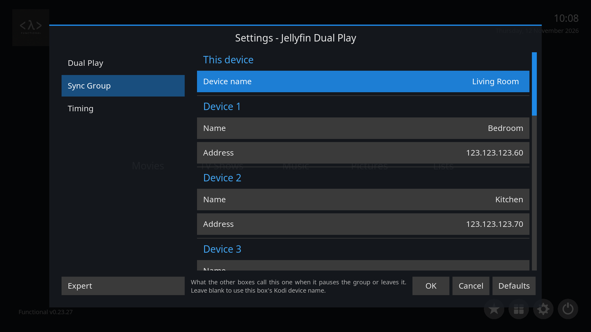
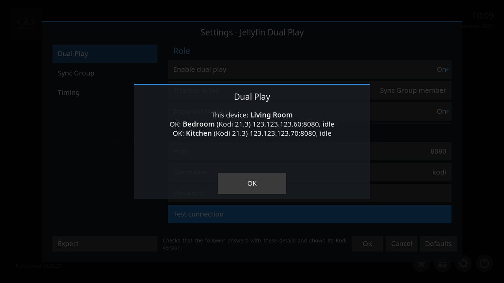
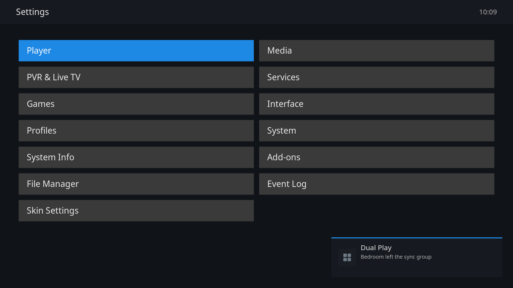

  

  <a href="#quick-start">Quick start</a> · <a href="#sync-group">Sync Group</a> · <a href="#settings">Settings</a> · <a href="#limits">Limits</a> · <a href="SETUP.md">Setup guide</a> · <a href="CHANGELOG.md">Changelog</a>

  
  
  
  

Plays the same Jellyfin item on two or more Kodi boxes at once, in sync, instead of Jellyfin's SyncPlay, which the Jellyfin for Kodi add-on does not support.

  

## Quick start

Every box needs the Jellyfin for Kodi add-on, signed in to the same Jellyfin server.

1. Install the add-on on **every** box with *Settings → Add-ons → Install from zip file* (you may need *Unknown sources* on first), or add the [DeliciousCoffee repository](https://github.com/c0def0rc0ffee/DeliciousCoffee) once and Kodi keeps it updated.
2. On the follower, open *Settings → Services → Control* and turn on **Allow remote control via HTTP** and **Allow remote control from applications on other systems**. Note the port (default 8080), username and password. Its role stays at the default, Follower.
3. On the leader, open the add-on's settings and set **This box is the** to Leader, then **Follower address** (for example `123.123.123.50`), **Port**, **Username** and **Password**.
4. Press **Test connection**. It should name the follower's Kodi version.

  

## Features

| | |
| --- | --- |
| **Leader and follower**: two boxes, the leader drives. | **Sync Group**: up to eleven named boxes. |
| **Pause and resume from any box** in a Sync Group. | **Late join**: a box switched on mid film joins at the right point. |
| **Departure notices** say which device left. | **No extra dependencies**: only Kodi's own Python. |

## Sync Group

For three or more boxes, or to control playback from any of them. On **every** box:

- set **This box is the** to *Sync Group member* and give it a **Device name**;
- switch on HTTP remote control as for the follower, with the same username and password everywhere;
- on the **Sync Group** tab, list every other box by name and address, in up to ten slots.

Whichever box starts a film hosts it and opens it everywhere. Stopping or exiting on any box pauses the others. The [setup guide](SETUP.md#sync-group-many-boxes-start-and-control-from-any-of-them) walks through it.

  

## Settings

| Setting | What it does |
| --- | --- |
| **Show notifications** | Popups when mirroring starts, a device cannot be reached or a device joins. Departure notices always show. |
| **Start timeout (seconds)** | How long the leader waits. Raise it for a slow box or remote library. |
| **Follower head start (ms)** | How far ahead the follower is released. Raise it if the follower lags, lower it if it leads. |
| **Periodically re-align** | Off by default. Turn on if slow drift bothers you. |
| **When this box stops** | Leader and follower only: stop, pause or leave the follower playing. A Sync Group always pauses the others. |

To swap roles, change **This box is the** on each box. Settings reload when the dialog closes, with no restart.

## Limits

- Leader and follower control is one way: pausing the follower does not pause the leader. Use a Sync Group for that.
- Sync is loose: boxes start within about half a second and stay within a second or two.
- Every box must reach the others on the LAN, with no client isolation or VLAN blocking.
- Kodi's web server is plain HTTP, so credentials travel base64 encoded, not encrypted. Do not reuse a password that matters, and never expose the web port to the internet.
- Every box must use the same Jellyfin add-on mode, add-on (dynamic) or native (library sync).

## Troubleshooting and more

[Troubleshooting](docs/TROUBLESHOOTING.md) · [How it works](docs/HOW-IT-WORKS.md) · [Tests](docs/TESTING.md)

## Licence

MIT. See [LICENSE](service.jellyfin.dualplay/LICENSE).
